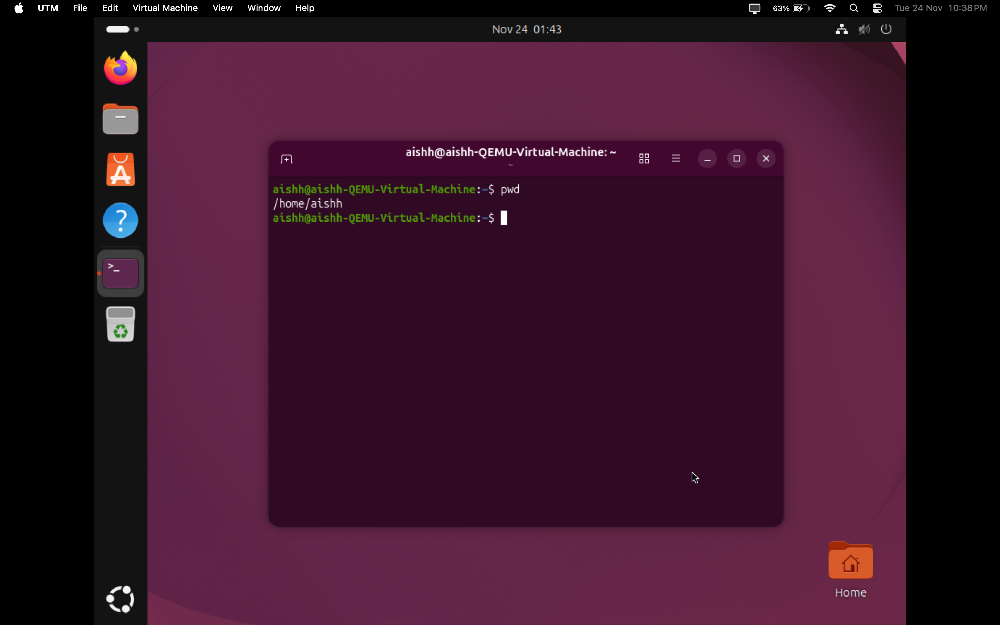
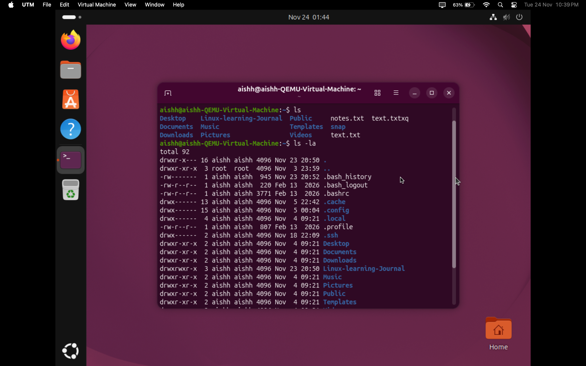
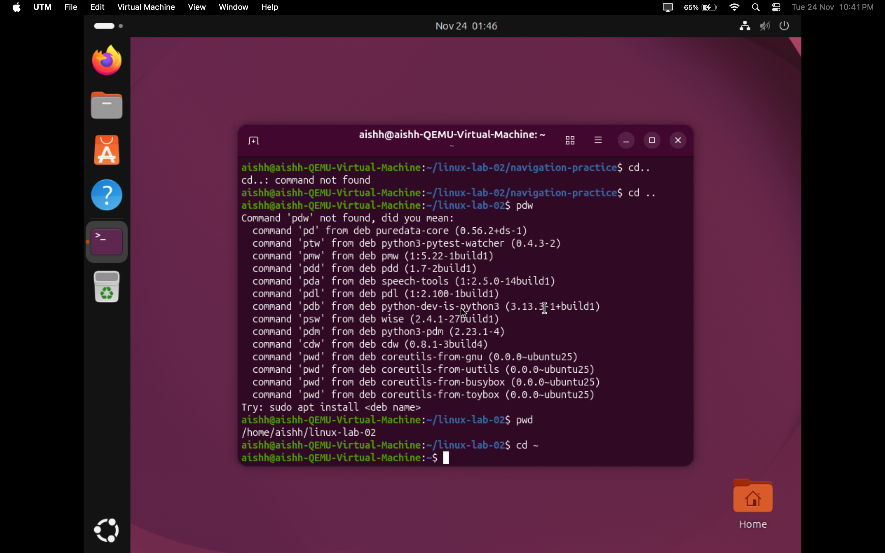
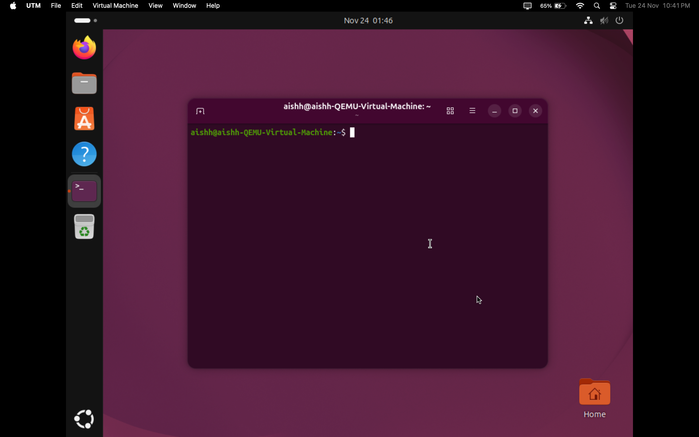

# Lab 02 – Linux Command-Line Navigation

## 1. Overview

This practical lab focuses on basic Linux command-line navigation using Ubuntu Linux.

It introduces four essential commands used to navigate and explore the Linux filesystem.

## 2. Objective

The objectives of this lab are:

- Understand the current working directory.
- List files and directories.
- Navigate between directories.
- Clear the terminal screen.
- Practise basic Linux terminal operations.

## 3. Environment

- Operating System: Ubuntu Linux
- Environment: UTM Virtual Machine
- Interface: Linux Terminal
- User: Standard Linux user

## 4. Commands Used

| Command | Description |
|---|---|
| `pwd` | Displays the current working directory |
| `ls` | Lists files and directories |
| `ls -la` | Displays detailed information, including hidden files |
| `cd` | Changes the current directory |
| `cd ..` | Moves one directory level backwards |
| `cd ~` | Navigates to the user's home directory |
| `mkdir -p` | Creates directories, including parent directories |
| `clear` | Clears the terminal screen |

## 5. Practical Implementation

### Step 1 – Check the Current Directory

Command:

```bash
pwd
```

Purpose: Displays the current working directory.

### Step 2 – List Files and Directories

Commands:

```bash
ls
ls -la
```

Purpose: Displays files, directories and hidden files.

### Step 3 – Create a Practice Directory

Command:

```bash
mkdir -p linux-lab-02/navigation-practice
```

Purpose: Creates a directory structure for practising navigation.

### Step 4 – Navigate into the Directory

Commands:

```bash
cd linux-lab-02/navigation-practice
pwd
```

Purpose: Changes the working directory and verifies the current location.

### Step 5 – Move to the Parent Directory

Commands:

```bash
cd ..
pwd
```

Purpose: Moves one directory level backwards and verifies the location.

### Step 6 – Return to the Home Directory

Command:

```bash
cd ~
```

Purpose: Navigates back to the user's home directory.

### Step 7 – Clear the Terminal

Command:

```bash
clear
```

Purpose: Clears the visible terminal output.

## 6. Screenshots

The following screenshots demonstrate the commands practised during this lab.

### Screenshot 1 – Current Working Directory



### Screenshot 2 – Listing Files and Directories



### Screenshot 3 – Directory Navigation



### Screenshot 4 – Clearing the Terminal



## 7. Key Learnings

Through this practical exercise, I learned:

- How to identify my current directory using `pwd`.
- How to list files and folders using `ls`.
- How to view hidden files using `ls -la`.
- How to navigate through directories using `cd`.
- How to move to the parent directory using `cd ..`.
- How to return to the home directory using `cd ~`.
- How to clear terminal output using `clear`.

## 8. Conclusion

This lab helped me understand the fundamentals of Linux command-line navigation.

These commands are essential for working with Linux systems, managing files and directories, and performing system administration tasks.

I completed this practical exercise using Ubuntu Linux in a UTM virtual machine.
