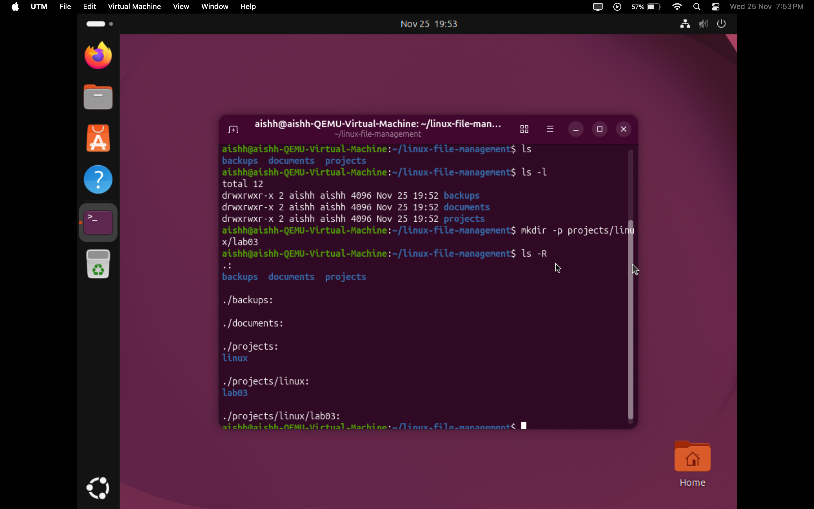
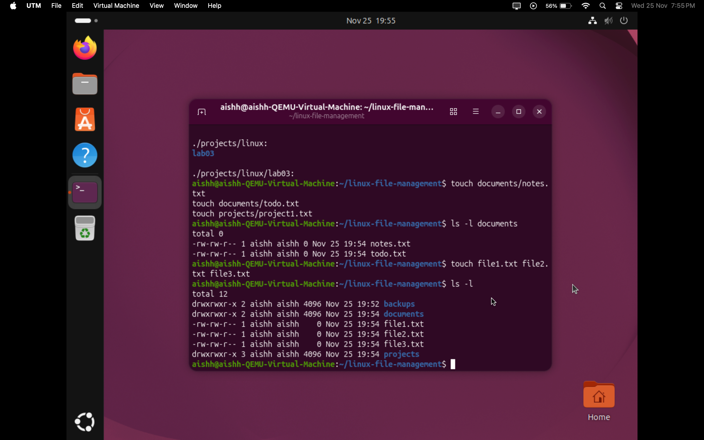
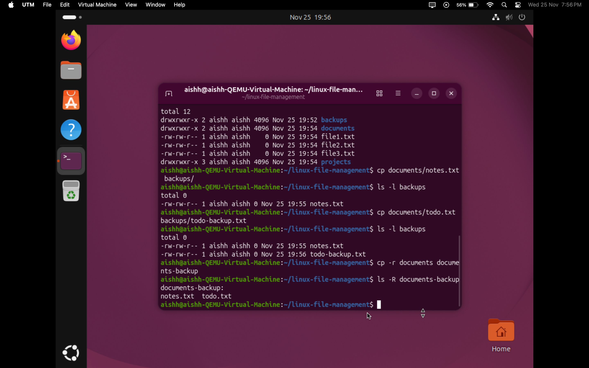
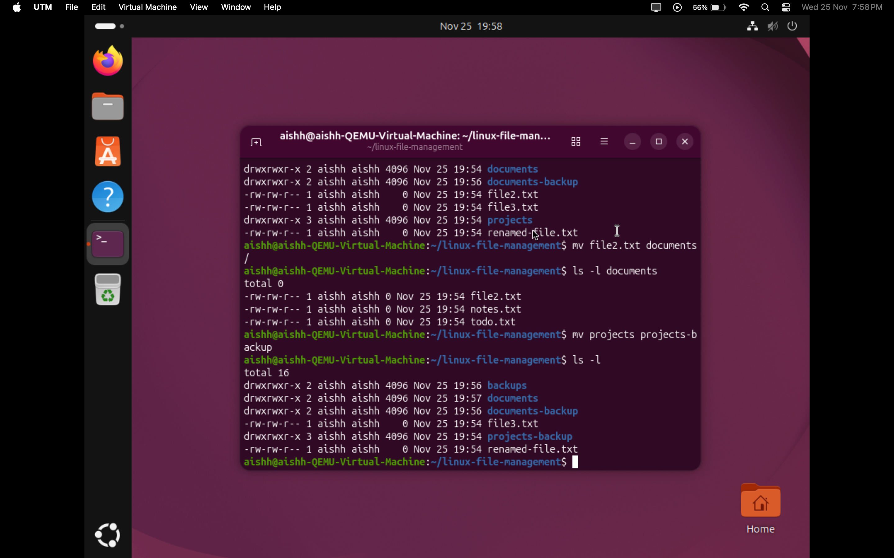
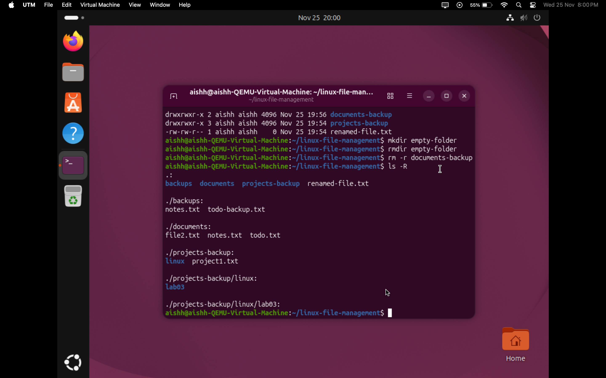
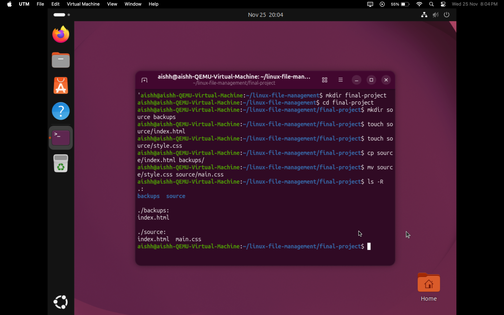

# Lab 03 – Linux File and Directory Management

## Objective
To understand and practice essential Linux file and directory management commands using Ubuntu.

## Commands Covered

| Command | Description |
|---|---|
| mkdir | Create directories |
| touch | Create empty files |
| cp | Copy files and directories |
| mv | Move or rename files and directories |
| rm | Remove files and directories |

---

## 1. mkdir – Create Directories

The `mkdir` command is used to create new directories.

```bash
mkdir linux-file-management
mkdir documents projects backups
mkdir -p projects/linux/lab03
```

**Purpose:** Create single, multiple, and nested directories.

### Screenshot


---

## 2. touch – Create Files

The `touch` command creates empty files.

```bash
touch documents/notes.txt
touch documents/todo.txt
touch projects/project1.txt
touch file1.txt file2.txt file3.txt
```

**Purpose:** Create empty files in Linux.

### Screenshot


---

## 3. cp – Copy Files and Directories

The `cp` command is used to copy files and directories.

```bash
cp documents/notes.txt backups/
cp documents/todo.txt backups/todo-backup.txt
cp -r documents documents-backup
```

**Purpose:** Copy individual files and entire directories.

### Screenshot


---

## 4. mv – Move and Rename Files

The `mv` command moves or renames files and directories.

```bash
mv file1.txt renamed-file.txt
mv file2.txt documents/
mv projects projects-backup
```

**Purpose:** Move files between directories and rename files or folders.

### Screenshot


---

## 5. rm – Remove Files and Directories

The `rm` command removes files and directories.

```bash
rm file3.txt
rmdir empty-folder
rm -r documents-backup
```

**Purpose:** Delete files and directories.

**Warning:** The rm command can permanently delete files. Always verify the file or directory path before execution.

### Screenshot


---

## 6. Final Practical Exercise

Combined practical exercise using all five commands.

```bash
mkdir final-project
cd final-project
mkdir source backup
touch source/index.html
touch source/style.css
cp source/index.html backup/
mv source/style.css source/main.css
ls -R
```

### Expected Directory Structure

```text
final-project/
├── backup/
│   └── index.html
└── source/
    ├── index.html
    └── main.css
```

### Screenshot


---

## Learning Outcomes

After completing this lab, I learned how to:

- Create directories using mkdir.
- Create empty files using touch.
- Copy files and directories using cp.
- Move and rename files using mv.
- Remove files and directories using rm.
- Organize files and directories in Ubuntu Linux.

## Conclusion

Successfully completed Lab 03 – Linux File and Directory Management.

This practical lab helped me understand essential Linux filesystem operations and improve my command-line skills using Ubuntu.
