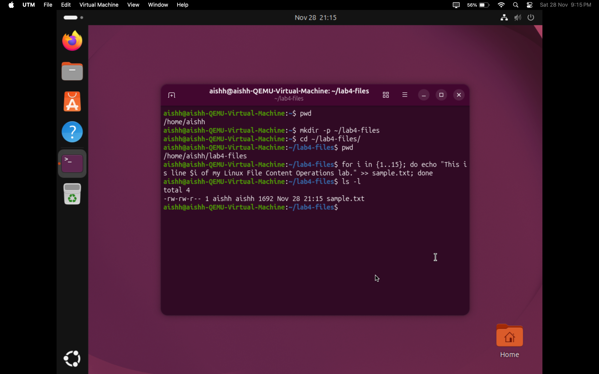
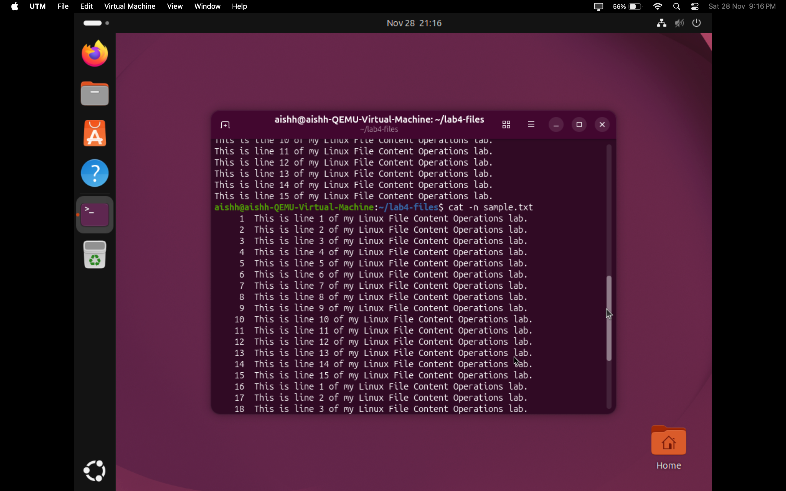
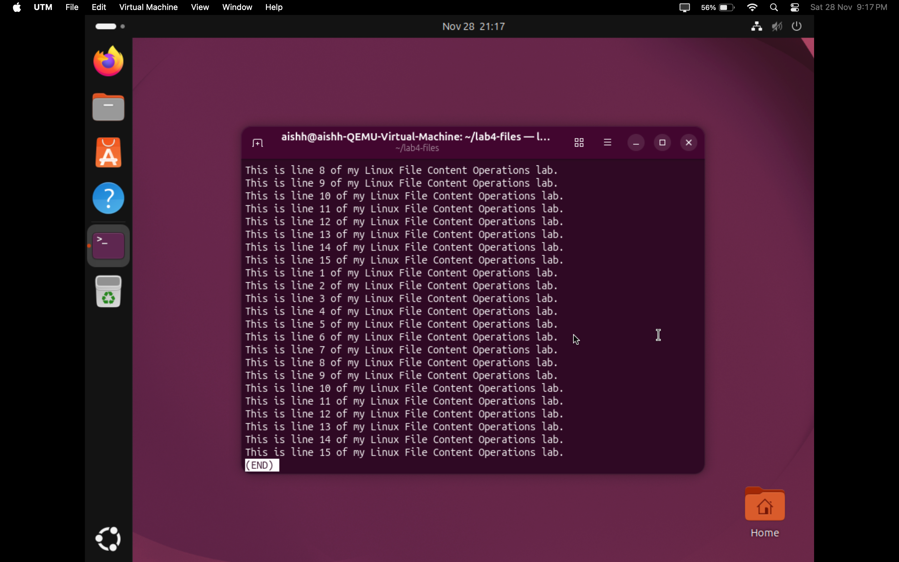
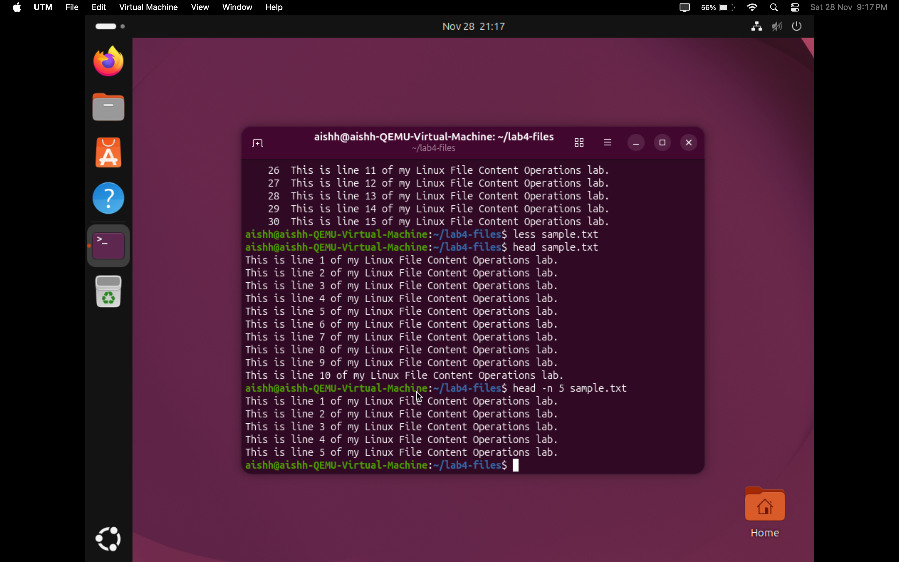
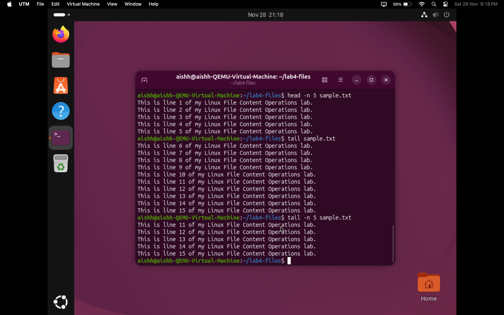

# Lab 04 – Linux File Content Operations

## 1. Objective

The objective of this practical lab is to understand how to view and read file contents in Linux using the `cat`, `less`, `head`, and `tail` commands.

## 2. Environment

- Operating System: Ubuntu Linux
- Virtualization: UTM Virtual Machine
- Terminal: Linux Bash Shell
- Level: Beginner

## 3. Commands Used

| Command | Description |
|---|---|
| `cat` | Displays the complete contents of a file |
| `less` | Reads file contents page by page |
| `head` | Displays the first lines of a file |
| `tail` | Displays the last lines of a file |

## 4. Practical Implementation

### Step 1 – Create a sample file

Created a working directory and a sample text file containing 15 lines.

```bash
mkdir -p ~/lab4-files
cd ~/lab4-files
for i in {1..15}; do echo "This is line $i of my Linux File Content Operations lab." >> sample.txt; done
ls -l
```

### Step 2 – Using the cat command

Displayed the complete contents of the sample file.

```bash
cat sample.txt
```

Displayed the file with line numbers.

```bash
cat -n sample.txt
```

### Step 3 – Using the less command

Opened the file in a page-by-page viewer.

```bash
less sample.txt
```

Pressed `q` to exit the viewer.

### Step 4 – Using the head command

Displayed the first 10 lines.

```bash
head sample.txt
```

Displayed the first 5 lines.

```bash
head -n 5 sample.txt
```

### Step 5 – Using the tail command

Displayed the last 10 lines.

```bash
tail sample.txt
```

Displayed the last 5 lines.

```bash
tail -n 5 sample.txt
```

## 5. Screenshots

Screenshots from this practical lab are stored in:

`screenshots/lab-04-file-content/`

### Screenshot 1 – Creating the sample file



### Screenshot 2 – cat command



### Screenshot 3 – less command



### Screenshot 4 – head command



### Screenshot 5 – tail command



## 6. What I Learned

- How to display complete file contents using `cat`.
- How to navigate large text files using `less`.
- How to display the first lines of a file using `head`.
- How to display the last lines of a file using `tail`.
- How to use command options such as `-n` to control the number of displayed lines.

## 7. Conclusion

Successfully completed Linux File Content Operations using Ubuntu Linux. Practised the `cat`, `less`, `head`, and `tail` commands and learned how to inspect text files through the Linux terminal.

**Lab Status:** Completed
